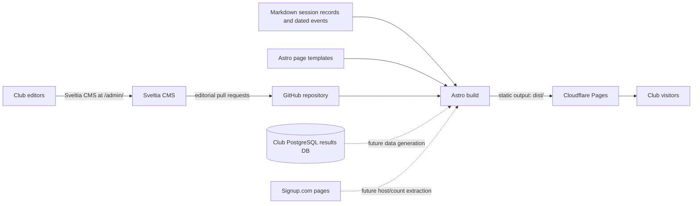

# Architecture

## Goal

Joondalup Bridge Club's public website is a small, fast, mobile-first information site. Visitors use it to choose a session, check partner requirements, plan a visit, learn about the club, and follow links to registration and bridge services.

The site is intended to be maintained in GitHub and published with Cloudflare Pages. Most public content should remain available as prebuilt static files. The site should not need a continuously running application server for ordinary pages.

## Current shape

The dotted data paths are plans, not working integrations. No result data or Signup.com counts are fetched by this code today.

## Implemented components

- **Astro:** Builds HTML and assets into `dist/`; `astro.config.mjs` sets `output: "static"`. There is no Cloudflare adapter or runtime API.
- **Pages:** `src/pages/` contains the home page, sessions, learning, calendar, club information, membership, committee, life members, newsletters, links, and location pages. Some legacy pages remain as aliases/redirect targets while routes are being consolidated.
- **Shared layout:** `src/layouts/SiteLayout.astro` provides the document head, navigation, footer, and shared global stylesheet.
- **Styles:** `src/styles/global.css` contains the visual system and responsive layouts.
- **Session content:** One Markdown file per weekly session under `src/content/sessions/`; `src/content.config.ts` validates match format, session format, restrictions, partner requirements, hosting/supervision, and signup URLs. `src/pages/index.astro` and `src/pages/sessions.astro` render the weekly program.
- **Event content:** Dated Markdown records under `src/content/events/` are separate from the recurring weekly program. Upcoming records are highlighted on the home and calendar pages; no event is fabricated when the collection is empty.
- **Page content:** Structured, editable content for the main pages is stored in `src/data/pages/*.json`; Astro page templates retain control of the layouts.
- **Editorial CMS:** `public/admin/` contains the Sveltia CMS interface and GitHub configuration. The CMS uses the `editorial_workflow` publishing mode, so changes are prepared as pull requests against `main`. Editors can update session records and the structured page data.
- **Signup links:** Hosted-session signup URLs are stored on their weekly session records. Event registration links are optional fields on dated event records.
- **Legacy paths:** `public/_redirects` retains redirects for old site URLs.
- **Club documents:** Newsletters, forms, resources, and external bridge links point to their supplied external destinations. The external hosts remain responsible for serving those files.

## Planned components

### Editorial publishing

Sveltia CMS is the editorial interface. The repository-side admin page, collections, and editorial pull-request workflow are configured. The Cloudflare OAuth Worker and GitHub OAuth app still need to be configured with account credentials and the deployed site hostname. Until that is done, editors can use Sveltia’s access-token sign-in. Astro templates and URLs are maintained in source; page text and repeatable lists are editable through structured JSON fields.

### Generated data

- The club maintains a PostgreSQL database that is updated daily with Pianola results.
- Pianola exposes links to its own site, not a data feed. No Usebio export is planned/available.
- The intended result pages and any derived statistics should be generated from the club database, not copied from a transient Pianola web page.
- Signup.com has distinct host signup pages (one host for each hosted session) and event registration pages (multiple participants; the site should publish a count, not a participant list).
- No data extraction, scheduled job, schema, or publication format has been implemented or selected. Do not fetch or expose personal signup details as a shortcut.

## Deployment contract

For a Git-connected Cloudflare Pages project:

- Production branch: `main`.
- Build command: `pnpm run build`.
- Build output directory: `dist`.
- A non-production branch such as `site-preview` is for preview builds; do not merge or push preview changes to `main` without the user's approval.

Cloudflare account/project setup is external to this repository. A successful local Astro build does not prove that a Pages deployment exists.

## Key paths

| Path | Responsibility |
| --- | --- |
| `src/pages/` | Page templates and routes |
| `src/layouts/SiteLayout.astro` | Shared header, navigation, footer |
| `src/content/sessions/` | Weekly session records |
| `src/content/events/` | Dated event records |
| `src/content.config.ts` | Session/event schemas and collection loaders |
| `src/data/pages/` | Structured editable page content |
| `public/admin/` | Sveltia CMS static admin and GitHub workflow configuration |
| `src/styles/global.css` | Shared responsive design |
| `public/_redirects` | Legacy route redirects |
| `docs/DECISIONS.md` | Decision record and unresolved choices |
| `docs/DESIGN.md` | Visual, content, and accessibility criteria |
